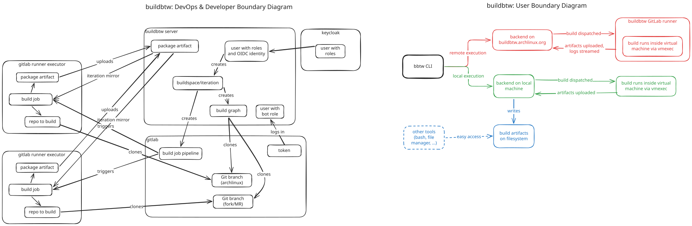

# Threat Model

This documentation describes security requirements of buildbtw that
must be followed so that the security boundaries hold.

## Scope

Components that are in scope:

- buildbtw components (API, Web, Server process, ...)
- GitLab custom executor
- Keycloak integration (OIDC)
- GitLab interaction (API, Git)

Explicitly out of scope:

- Keycloak, GitLab, and other platforms themselves beyond the integration above
- Security of the hosts running buildbtw
- rogue CA's issuing valid TLS certificates

## Critical Preconditions

For the current buildbtw implementation and the current threat model the following
aspects are non-optional and critical preconditions that must not be violated in
the current state under any circumstances:

### Pipelines

The gitlab-ci-templates as well as packaging repositories must be specified and
configured in a way that never allows and runs any other pipelines than API
pipelines scheduled by buildbtw itself. Running any kind of pipelines,
including but not limited to forks, merge-requests, push, web etc must not
happen in the current state of things, including auxiliary jobs like linting.
This will be revisited and defined in the future.

Currently the boundary diagram also documents flows for forks and merge-requests
outside of the `archlinux/packaging/packages` namespace, however this is explicitly
considered only in he future when this document is also revisited.

### Staging Deployments

It must be impossible to release built artifacts produced on staging deployments
and review apps. As a current guarantee while preserving all user expectations
it is required to configure a boolean in buildbtw depending on if the environment
is production or not. For any non production deployments, the `build-inside-vm.sh`
or dispatcher code must append a comment with random data to the `PKGBUILD` before
building, which guarantees that all artifacts are as expected but cannot be released
via `dbscripts` as their checksum mismatches.

If this is implemented in `build-inside-vm.sh`, it must be guaranteed that the debug
trace log of the shell script does not expose the exact random string appended.

## Boundary diagram

Refer to the [Architecture Overview](./Architecture_Overview.md) for additional
information.

## Assets

| Asset | Reason |
|---|---|
| Package artifacts / pacman repositories | Important for integrity: Used as dependencies by builds in the same iteration |
| Official package repositories | Important for integrity: It must be guaranteed that artifacts are never release from non production deployments |
| Bot/System API Tokens | Used for interacting with the privileged buildbtw API |
| Executor API token | Used for uploading builds and logs |
| GitLab API token | Privileges to interact with GitLab like scheduling pipelines |
| OIDC client secret | Impersonate OIDC users |
| Session cookies | Authentication of buildbtw Web users |

## Requirements

### Web CSRF

### Web Session fixation

### API cross-site requests

### Authentication

### Pipelines

### Git sources

### Executor logs

### Executor artifacts

### Deployment artifacts

### TLS

### Shell arguments

### Deployment secrets

